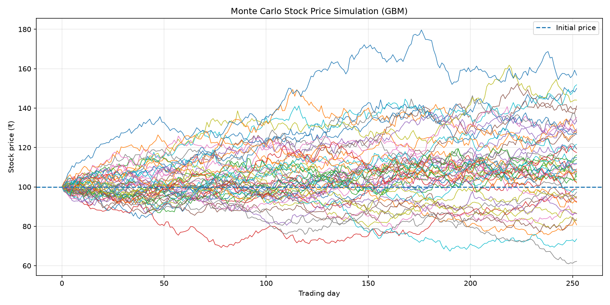

# Monte Carlo Stock Price Simulator

A Python-based Monte Carlo simulation that models possible stock-price movements over one year using Geometric Brownian Motion (GBM).

## Project Overview

Stock prices are uncertain and can move in many possible ways. This project simulates thousands of potential price paths to explore investment risk and understand the distribution of possible outcomes.

## Features

- Simulates 10,000 possible stock-price paths.
- Uses Geometric Brownian Motion (GBM).
- Estimates the probability of ending below the initial price.
- Calculates the 95% Value at Risk (VaR) threshold.
- Compares simulated results with the theoretical expected price.
- Visualizes simulated stock-price paths using Matplotlib.

## Model Assumptions

- Initial stock price: ₹100
- Annual expected return: 8%
- Annual volatility: 20%
- Time horizon: 252 trading days
- Number of simulations: 10,000

## Technologies Used

- Python
- NumPy
- Matplotlib

## How to Run

1. Clone or download this repository.
2. Create and activate a Python virtual environment.
3. Install dependencies:

   ```bash
   python -m pip install -r requirements.txt
   ```

4. Run the simulator:

   ```bash
   python main.py
   ```

The program prints summary statistics and generates `simulation.png`.

## Risk Metrics

- **Probability of loss:** The proportion of simulated final prices below the initial price.
- **95% Value at Risk (VaR):** The estimated loss threshold at the 5th percentile of simulated final prices, relative to the initial price.
- **Expected final price:** Compared with the theoretical expectation under the GBM model.

## Limitations

This is an educational simulation, not a stock-price prediction tool. Results depend on the assumed return and volatility. The model assumes constant parameters and does not capture all real-world market behavior. VaR is a model-based estimate, not a guarantee or maximum possible loss.

## Future Improvements

- Compare results across different numbers of simulations.
- Add confidence intervals and additional risk measures.
- Test different return and volatility assumptions.
- Add automated tests and more visualizations.
## Simulation Results

The Monte Carlo simulation generates 10,000 possible stock price paths over 252 trading days using Geometric Brownian Motion.


